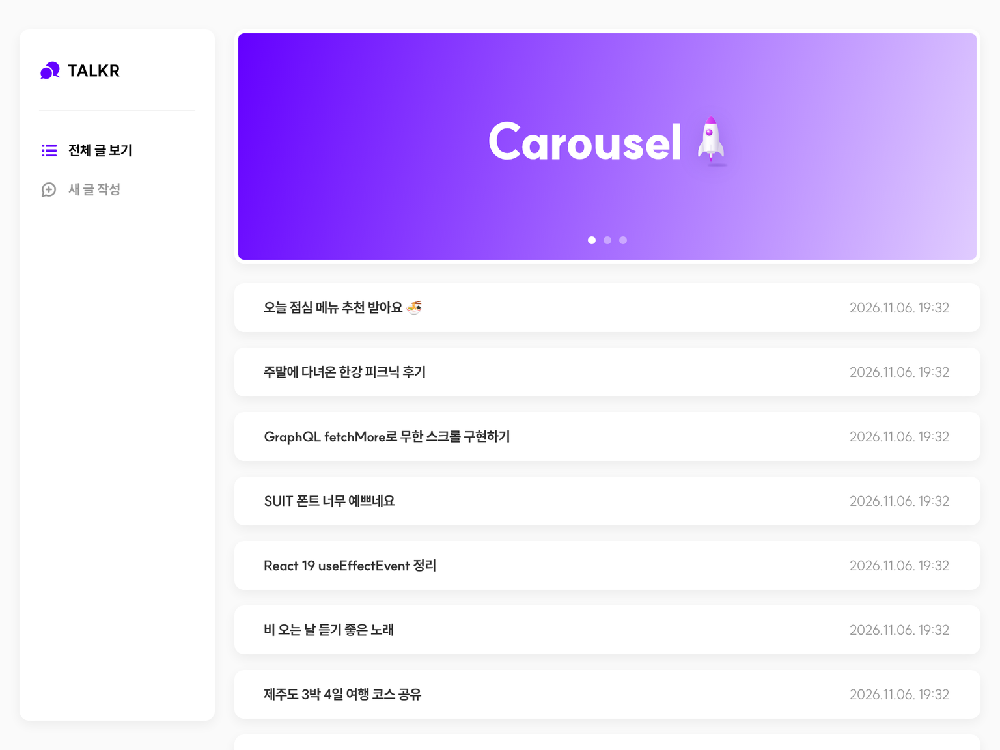
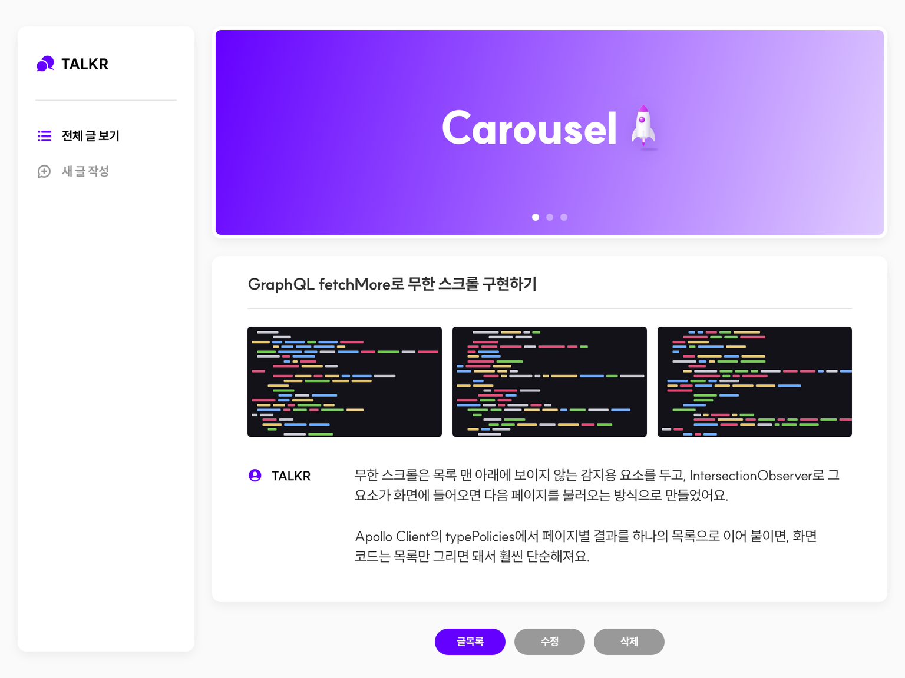
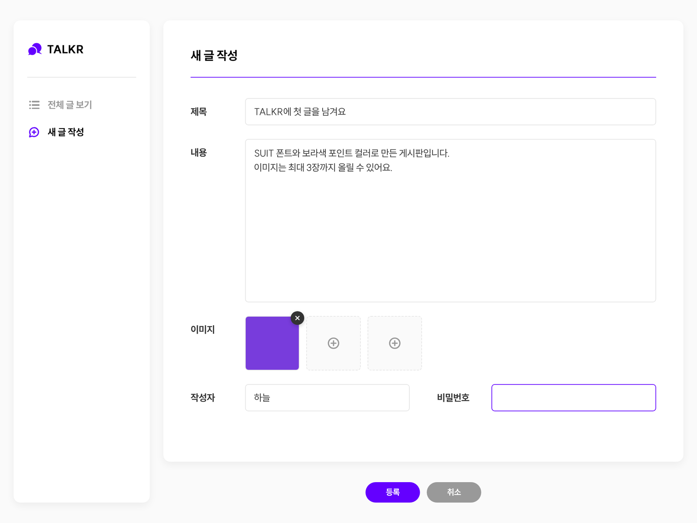
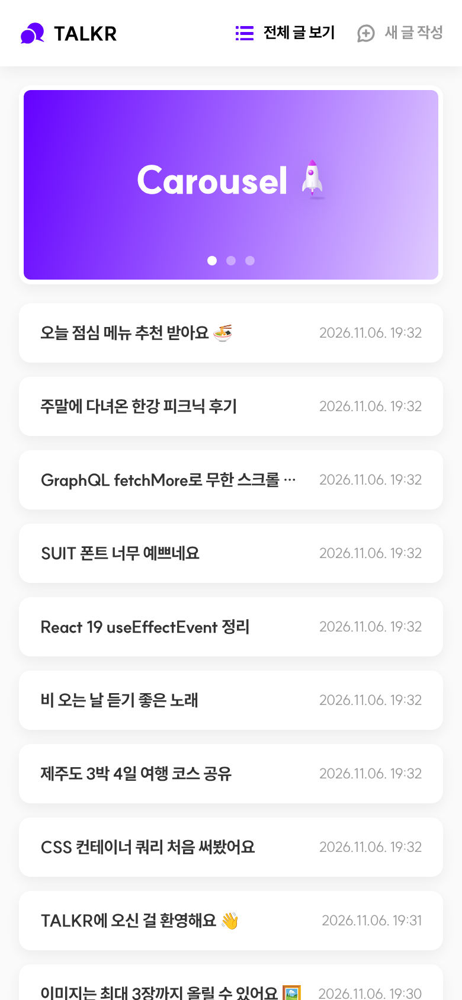

# TALKR 💬

🔗 **배포 주소**: https://graphql-board-testing.vercel.app

연습용으로 만든 **게시판 웹 앱**입니다.
피그마 시안(1024 × 768)을 기준으로 목록 · 상세 · 등록 · 수정 · 삭제 화면을 구현하고,
**GraphQL 서버까지 직접 만들어** 연결했습니다.

🔗 **배포 주소**: _(Vercel 배포 후 주소를 적어주세요)_

|                전체 글 보기                |                               게시글 상세                               |
| :----------------------------------------: | :---------------------------------------------------------------------: |
|  |                              |
|               **새 글 작성**               |                               **모바일**                                |
|   |  |

<br />

## 주요 기능

| 화면                                     | 기능                                                                                                                                    |
| ---------------------------------------- | --------------------------------------------------------------------------------------------------------------------------------------- |
| **전체 글 보기** `/boards`               | 게시글 목록(제목 · 작성일), 스크롤하면 10개씩 더 불러오는 **무한 스크롤**, 로딩 스켈레톤, 빈 목록 / 에러 안내                           |
| **게시글 상세** `/boards/[boardId]`      | 제목 · 이미지(최대 3장) · 작성자 · 내용(줄바꿈 유지), **비밀번호를 확인하는 삭제 모달**, 없는 글 안내                                   |
| **새 글 작성** `/boards/new`             | 필수값 검사(빈 칸 아래 안내 + 첫 번째 빈 칸으로 커서 이동), 이미지 업로드(미리보기 · 형식/용량 검사 · 교체 · 삭제), 작성 취소 확인 모달 |
| **게시물 수정** `/boards/[boardId]/edit` | 기존 내용 채우기, 작성자는 수정 불가(비활성화), **바뀐 값만 전송**, 비밀번호 확인(틀리면 안내)                                          |
| **공통**                                 | 캐러셀 배너(4초 자동 재생 · 점 버튼 · 스와이프 · 마우스를 올리면 멈춤), 현재 메뉴 표시 사이드바, 404 페이지                             |

- **입력칸 상태**: 피그마 가이드의 `기본 / 클릭 시 / 비활성화 / 완료 시` 4가지 상태를 그대로 적용했습니다.
- **반응형**: 768px 미만에서는 사이드바가 상단 바로 바뀌고, 입력 폼이 좁아지면 라벨이 입력칸 위로 올라갑니다.
- **접근성**: label 연결, 에러 메시지 `role="alert"`, 키보드 포커스 표시, ESC로 모달 닫기, '동작 줄이기' 설정 시 자동 재생 중지.

<br />

## 구조

화면과 서버가 **하나의 Next.js 프로젝트** 안에 함께 있습니다.

```
브라우저 (Next.js 화면 + Apollo Client)
   │   POST /api/graphql   (이미지는 multipart로 전송)
   ▼
GraphQL 서버 — GraphQL Yoga  (src/app/api/graphql)
   ├── 게시글 → PostgreSQL      배포: Neon         / 내 컴퓨터: PGlite (.local-data/pglite)
   └── 이미지 → 파일 저장소      배포: Vercel Blob  / 내 컴퓨터: .local-data/uploads
```

내 컴퓨터에서는 **아무것도 설치·설정하지 않아도** 내장 데이터베이스(PGlite)로 바로 실행되고,
배포 환경에서는 Vercel이 넣어주는 환경 변수를 보고 자동으로 Neon · Vercel Blob을 사용합니다.

<br />

## 기술 스택

| 구분         | 사용 기술                                                            |
| ------------ | -------------------------------------------------------------------- |
| 화면         | Next.js 16 (App Router), React 19, TypeScript                        |
| 데이터 요청  | Apollo Client 4, apollo-upload-client (이미지 업로드)                |
| 서버         | GraphQL Yoga (Next.js API Route), bcryptjs (비밀번호 암호화)         |
| 데이터베이스 | PostgreSQL — Neon (배포) / PGlite (내 컴퓨터)                        |
| 이미지 저장  | Vercel Blob (배포) / 로컬 폴더 (내 컴퓨터)                           |
| 스타일       | CSS Modules, CSS 변수(디자인 토큰), 컨테이너 쿼리                    |
| 폰트         | [SUIT Variable](https://sun.fo/suit) (`next/font/local`로 직접 포함) |

<br />

## GraphQL API

주소: `/api/graphql` — 개발 모드(`npm run dev`)에서는 브라우저로 이 주소를 열면 **GraphiQL**에서 API를 직접 실행해 볼 수 있습니다.

| 종류     | 이름                                               | 설명                                                 |
| -------- | -------------------------------------------------- | ---------------------------------------------------- |
| Query    | `fetchBoards(page)`                                | 게시글 목록 (한 페이지 10개, 최신순)                 |
| Query    | `fetchBoardsCount`                                 | 전체 게시글 수                                       |
| Query    | `fetchBoard(boardId)`                              | 게시글 하나                                          |
| Mutation | `createBoard(createBoardInput)`                    | 새 글 등록 (비밀번호는 bcrypt로 암호화해 저장)       |
| Mutation | `updateBoard(boardId, password, updateBoardInput)` | 수정 — 비밀번호가 맞아야 함                          |
| Mutation | `deleteBoard(boardId, password)`                   | 삭제 — 비밀번호가 맞아야 함, 첨부 이미지도 함께 삭제 |
| Mutation | `uploadFile(file)`                                 | 이미지 업로드 (JPG · PNG · WEBP · GIF, 4MB 이하)     |

<br />

## 실행 방법 (내 컴퓨터)

```bash
npm install
npm run dev
```

브라우저에서 http://localhost:3000 을 열면 `/boards`로 이동합니다.
처음 실행하면 `.local-data` 폴더에 데이터베이스가 만들어지고 안내 글 3개가 들어갑니다.
처음부터 다시 시작하고 싶으면 `.local-data` 폴더를 지우면 됩니다.

<br />

## 무료로 배포하기 (Vercel + Neon + Vercel Blob)

모두 무료 플랜으로 배포할 수 있습니다.

1. [vercel.com](https://vercel.com)에 GitHub 계정으로 로그인 → **Add New → Project** → 이 저장소 **Import** → **Deploy**
2. 배포된 프로젝트의 **Storage** 탭 → **Create Database** → **Neon (Postgres)** 선택 → 무료 플랜으로 만들고 이 프로젝트에 **Connect**
3. 다시 **Storage** 탭 → **Create** → **Blob** 선택 → 접근 방식은 **Public** → 이 프로젝트에 **Connect**
4. **Deployments** 탭 → 가장 위 배포의 **⋯ → Redeploy** (연결한 저장소 정보를 반영하기 위해 한 번 더 배포)

테이블과 안내 글은 첫 요청 때 자동으로 만들어집니다.

| 환경 변수               | 넣어주는 곳       | 용도                |
| ----------------------- | ----------------- | ------------------- |
| `DATABASE_URL`          | Neon 연결 시 자동 | 게시글 데이터베이스 |
| `BLOB_READ_WRITE_TOKEN` | Blob 연결 시 자동 | 이미지 저장소       |

<br />

## 폴더 구조

```
src
├── app                              # 라우트
│   ├── boards
│   │   ├── page.tsx                 # 전체 글 보기
│   │   ├── new/page.tsx             # 새 글 작성
│   │   └── [boardId]
│   │       ├── page.tsx             # 게시글 상세
│   │       └── edit/page.tsx        # 게시물 수정
│   ├── api
│   │   ├── graphql/route.ts         # GraphQL 서버 주소
│   │   └── uploads/[name]/route.ts  # (내 컴퓨터 전용) 저장한 이미지 보여주기
│   ├── layout.tsx                   # 폰트 · Apollo · 레이아웃
│   └── globals.css                  # 디자인 토큰(색상 · 굵기 · 그림자)
├── server                           # 서버 코드
│   ├── schema.ts                    # GraphQL 스키마 + resolver (검사 · 비밀번호 확인)
│   ├── db.ts                        # DB 연결 (Neon / PGlite), 테이블 자동 생성
│   └── storage.ts                   # 이미지 저장 (Vercel Blob / 로컬 폴더)
├── commons
│   ├── apollo                       # Apollo Client 설정 (무한 스크롤 캐시 병합)
│   ├── layout                       # 사이드바(navigation), 캐러셀(banner)
│   ├── icons                        # SVG 아이콘
│   ├── fonts                        # SUIT 폰트 + 라이선스
│   ├── libraries                    # 날짜 형식, 에러 메시지 등 유틸
│   └── types                        # 게시글 타입
└── components
    ├── boards-list                  # 목록      (index · hook · queries · styles)
    ├── boards-detail                # 상세 + 삭제
    ├── boards-write                 # 등록/수정 공용 폼 (+ 이미지 업로드, 검사)
    ├── boards-edit                  # 수정할 글 불러오기
    └── commons                      # 버튼, 확인 모달
```

화면 컴포넌트마다 **화면(index.tsx) / 로직(hook.ts) / GraphQL(queries.ts) / 스타일(styles.module.css)** 을 나눠서 관리했습니다.

<br />

## 구현하면서 고민한 점

### 1. 서버를 직접 만들기

처음에는 외부 연습용 서버를 썼지만, 서버가 언제 닫힐지 모르고 다른 사람의 글이 섞이는 문제가 있었습니다.
그래서 **화면이 쓰던 query · mutation 이름은 그대로 두고** 같은 모양의 GraphQL 서버를 직접 만들었습니다. 덕분에 화면 코드는 거의 바꾸지 않았습니다.
직접 만들면서 아래 부분을 개선했습니다.

- **비밀번호 암호화**: 비밀번호를 그대로 저장하지 않고 bcrypt로 암호화해 저장합니다.
- **삭제도 비밀번호 확인**: 수정뿐 아니라 삭제할 때도 비밀번호가 맞아야 합니다.
- **서버 쪽 검사**: 화면 검사와 별개로 서버에서도 필수값 · 글자 수 · 이미지 개수 · 파일 형식/용량을 확인하고, 이 서비스가 저장한 이미지 주소만 받습니다.
- **이미지 정리**: 수정 중 뺀 이미지와 삭제한 글의 이미지는 저장소에서도 지웁니다.

### 2. 설정 없이 바로 실행

데이터베이스를 설치하지 않아도 `npm run dev`만으로 실행되도록, 내 컴퓨터에서는 WebAssembly로 동작하는 PostgreSQL(PGlite)을 씁니다.
배포 환경과 **같은 SQL**을 쓰기 때문에, 로컬에서 확인한 동작이 배포에서도 그대로 동작합니다.

### 3. 무한 스크롤과 Apollo 캐시

`fetchBoards`는 `page`마다 10개씩 내려줍니다. `typePolicies`의 `merge`에서 페이지 결과를 하나의 목록으로 이어 붙이고,
`IntersectionObserver`로 목록 끝이 보이면 다음 페이지를 불러옵니다.
글을 등록 · 삭제하면 1페이지를 다시 받아와 목록을 새로 시작하고, 페이지를 넘기는 사이 새 글이 올라와 생기는 중복은 `read`에서 걸러냅니다.

### 4. Next.js 16의 화면 보관(Activity) 대응

Next.js 16은 방문했던 페이지를 지우지 않고 숨겨서 보관합니다(뒤로 가기 시 스크롤 · 입력값 유지).
이 때문에 생기는 문제들을 직접 확인하고 처리했습니다.

- 숨겨진 상세 페이지에서 `useParams()`가 **현재 주소**의 값을 돌려줘 게시글 번호가 사라지는 문제 → 페이지가 받은 `params`를 `use()`로 읽도록 변경
- 글 등록 후 다시 '새 글 작성'에 들어오면 이전 내용이 남아 있는 문제 → 등록 성공 시 폼 초기화
- 열어둔 모달이 다시 돌아왔을 때 떠 있는 문제 → 화면이 숨겨질 때 모달 닫기

### 5. 시안과 똑같이 보이도록

피그마 내보내기 이미지를 픽셀 단위로 측정해서 간격 · 크기 · 색을 맞췄습니다.
(사이드바 200px, 카드 모서리 10px, 목록 높이 50px · 간격 16px, 본문 14px · 자간 -2.5%, 배너 그라데이션 `#6400FF → #E0CCFF` 등)
같은 조건으로 렌더링해 비교했을 때 시안의 굵은 글씨가 Bold(700)보다 약간 더 두꺼워서, 가변 폰트의 장점을 살려 굵기를 `750`으로 맞췄습니다.

### 6. 사이드바 활성 메뉴

시안의 상세 화면에는 '새 글 작성'이 활성화되어 있지만, 상세 · 수정은 목록에서 이어지는 흐름이라
**'새 글 작성' 화면에서만 '새 글 작성'**, 나머지 화면에서는 **'전체 글 보기'**가 활성화되도록 했습니다.

<br />

## 폰트 라이선스

SUIT는 [SIL Open Font License 1.1](src/commons/fonts/SUIT-LICENSE.txt)을 따르는 무료 폰트입니다. (© SUNN, https://sun.fo/suit)
